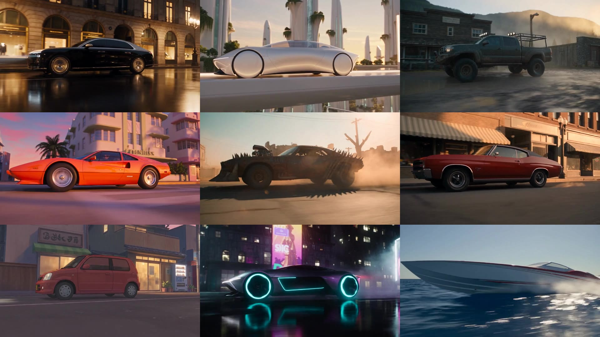
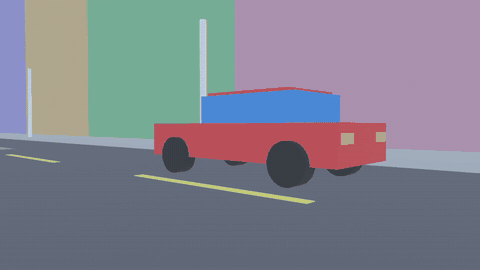

# one-camera-many-looks

**One camera move, blocked in Blender with colored boxes, re-rendered by a video model in nine
different looks while the camera stays locked.**

[](media/grid.mp4)

*Click the image to play the 10-second grid (`media/grid.mp4`).*

- **Block the shot, not the look.** A headless Blender script builds the shot from primitives: a
  red box car on a street, grey and colored blocks for buildings and poles, and one camera move.
- **The blocking drives the camera.** The blocking video goes to a video model (Seedance 2.5) as
  the motion reference, with a text prompt per look. The camera part of the prompt is the same for
  every look. Only the look changes.
- **Nine looks, one grid.** Luxury sedan, future utopia, off-road truck, open-world game, desert
  wasteland, 1970s muscle car, anime, cyberpunk rain, and a speedboat on the ocean. A small ffmpeg
  script tiles them into a 3x3 grid.

## The blocking



`blocking/build_blocking.py` (Blender 5, Eevee, 10 s, 24 fps, 1280x720):

- The car drives forward at 9 m/s.
- The camera starts low (1 m) on the car's left, about 6 m out. It slides from the rear quarter to
  the front quarter, then cranes up and ahead to a high view looking down as the car comes toward it.
- Four key positions are joined by one smooth curve (cubic Hermite with time-scaled tangents), so
  the camera never stops. `blocking/speed.py` measures it: the slowest camera speed relative to the
  car is 1.8 m/s.
- Blender 5 note: `action.fcurves` is gone (slotted actions), so the script keys every frame.

```bash
blender -b -P blocking/build_blocking.py -- --out out/blocking            # 1280x720 frames + .blend
blender -b -P blocking/build_blocking.py -- --out out/preview --preview   # 640x360 preview
blender -b out/blocking/blocking.blend -P blocking/speed.py               # camera speed check
ffmpeg -framerate 24 -i out/blocking/frames/f_%04d.png -pix_fmt yuv420p out/blocking.mp4
```

## The look prompts

Each `looks/lookN_*/prompt.txt` has three parts:

1. **`[Camera and layout]`**, the same in all nine: copy Video 1's camera path, height, speed,
   framing, and timing in one continuous 10-second shot with no cuts. Use Video 1 for camera, layout,
   and motion only, so none of its flat colors or simple shapes appear.
2. **`[Look]`**: what the red box car, the blocks, and the poles become, plus the light and the
   lens. Every look describes a made-up brand or place, with no real brands, logos, or franchise names.
3. **A sound line** in angle brackets.

Each look was rendered once: 10 s at 720p, with the blocking as the single reference video. All
nine came back as one shot with no cuts, and the camera matched the blocking at 0.2, 5, 7, and 9.9 s.

## The grid

```bash
./make_grid.sh grid.mp4 look1.mp4 look2.mp4 ... look9.mp4   # 3x3, 1920x1080, 10 s, no sound
```

## What is withheld

The browser tools that upload the reference, type and check each prompt, and submit the job drive a
hosted service on the author's own account. They are withheld (`withheld/submit/README.md`). Any
video model that takes a reference video and a text prompt can stand in.

## About

Built by Mike Huang ([mhfx.ai](https://mhfx.ai), [GitHub](https://github.com/mhuangfx)), with
Claude Code as the engineering partner. Mike chose the shot and the nine looks.

Code: MIT licence (see [`LICENSE`](LICENSE)). The videos and images in `media/` are Mike Huang's
own work.
