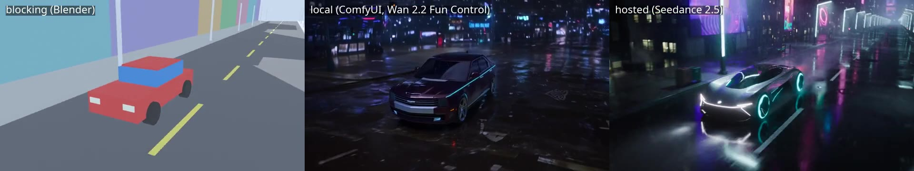
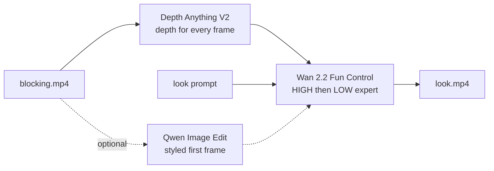

# Local route: ComfyUI on one GPU

The same blocking drives an open model on your own machine. No account or upload is needed.



*Left: the Blender blocking. Middle: the local render (Wan 2.2 Fun Control). Right: the hosted
render (Seedance 2.5). Same look prompt. Video: [`media/compare_look8.mp4`](../media/compare_look8.mp4).*

## How it works



- **The depth carries the camera.** Every blocking frame becomes a depth map, and the video model
  is conditioned on it. The camera path, framing, and timing come from the blocking, not from the
  prompt.
- **The text carries the look.** The script uses the `[Look]` part of a look prompt. The camera
  part is not needed.
- **Optional first frame.** Qwen Image Edit can turn frame 0 of the blocking into the look first,
  and the video then starts from that image (`--first-frame` mode is the default; `--text-only`
  skips it).

## The one setting that matters

`--control` (depth strength) and `--control-end` (share of the steps that use depth):

| Setting | Camera | Car and street |
|---|---|---|
| 1.0 / 1.0 | follows the blocking exactly | keeps the blocking's box shapes |
| 0.75 / 0.6 | follows the blocking | partly boxy |
| 0.5 / 0.4 (default) | followed the blocking for the cyberpunk look | real car and street |

The right value depends on the look. In our tests, a daylight look at 0.5 / 0.4 let the prompt take
over the camera, so raise `--control` until the camera holds, then stop.

## Run it

```bash
python3 comfyui/run_look.py --blocking media/blocking.mp4 \
    --look looks/look8_cyberpunk/prompt.txt --out out/look8_local --text-only
```

- 832x480, 117 frames at 12 fps (9.75 s), 8 steps (4 HIGH + 4 LOW) with the Lightx2v distill LoRA.
- On one RTX 4090: about 3 to 4 minutes for the video once the models are loaded (the first run loads
  them). The first-frame stage adds about 20 seconds after its first load.
- The script saves both workflows next to the output as API-format JSON. Ready-made copies are here:
  `workflow_video_text_only.json`, `workflow_video_first_frame.json`, `workflow_first_frame.json`.

## What ComfyUI needs

Custom nodes: ComfyUI-WanVideoWrapper, ComfyUI-KJNodes, ComfyUI-VideoHelperSuite,
comfyui-nikosis-preprocessors (Depth Anything V2).

Models (file names as the workflows use them):

| Folder | File |
|---|---|
| `diffusion_models/Fun/` | `Wan2_2-Fun-Control-A14B-HIGH_fp8_e4m3fn_scaled_KJ_fixed.safetensors`, `...-LOW_...` |
| `vae/wanvideo/` | `Wan2_1_VAE_bf16.safetensors` |
| `text_encoders/` | `umt5_xxl_fp16.safetensors` |
| `loras/WanVideo/Lightx2v/` | `lightx2v_T2V_14B_cfg_step_distill_v2_lora_rank32_bf16.safetensors` |
| first-frame stage | `qwen_image_edit_2509_fp8_e4m3fn.safetensors`, `Qwen-Image-Edit-2509-Lightning-8steps-V1.0-bf16.safetensors`, `qwen_2.5_vl_7b_fp8_scaled.safetensors`, `qwen_image_vae.safetensors` |

The depth model downloads itself on first use.
